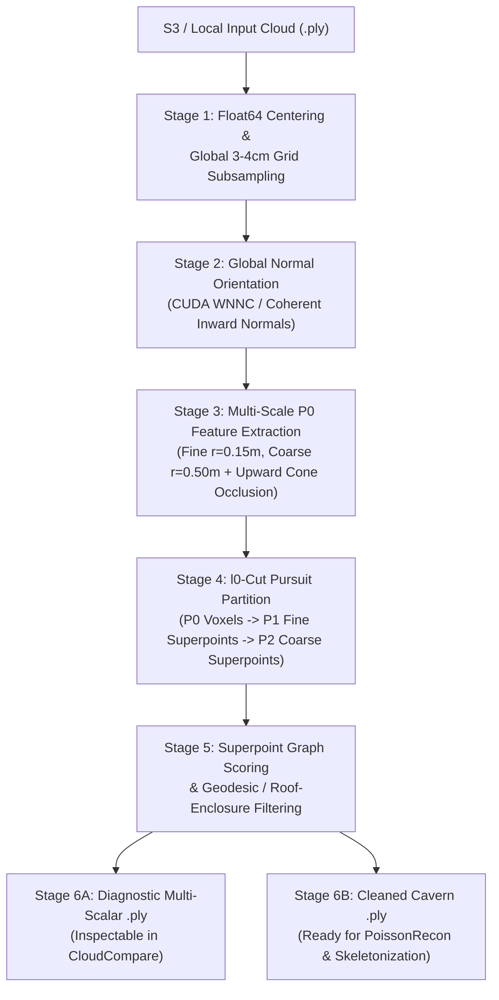

# Superpoint & Multi-Scale Geometric Filtering Pipeline for Speleological Point Clouds

## 1. Overview & Problem Statement

Speleological 3D point clouds acquired via Terrestrial Laser Scanning (TLS) and mobile SLAM LiDAR frequently capture both the subterranean **cavern interior** (bedrock walls, vaulted ceilings, floors, stalactites, stalagmites, breakdown boulders) and **exterior non-cavern clutter** near cave entrances, dolines, and skylights (trees, bushes, hanging roots, surface terrain outside the drip line, and anthropogenic scanner artifacts).

When uncleaned point clouds are fed into the repository's reconstruction and skeletonization pipeline ([src/pipeline_main.cpp](file:///home/projval/Documents/cgal/src/pipeline_main.cpp)):
1. **Screened Poisson Reconstruction (`PoissonRecon`)** attempts to fit watertight isosurfaces around high-entropy foliage and exterior talus slopes, ballooning octree complexity and distorting entrance topology.
2. **Mean Curvature Flow Skeletonization (`skeleton_extraction`)** generates spurious topological branches extending into tree canopies and exterior terrain.

This document records the **architectural review, empirical dataset audit, engineering decisions, and step-by-step implementation specification** for filtering non-cavern geometry using **Superpoint Transformer (SPT) $\ell_0$-cut pursuit partitioning** combined with **CloudCompare-compatible multi-scale geometric and enclosure descriptors**.

---

## 2. Empirical Audit of the Remote Dataset & Hardware Constraints

### 2.1 Remote S3 Dataset Audit (`http://150.164.212.12:8010/`)

The remote S3 Sync Manager (`bucket: ufmg-vale-esp-artefatos`, `region: us-east-2`) hosts **38 point clouds** under `point-clouds/` and **47 meshes** under `meshes/`. Inspecting the `.ply` headers of all 38 remote point clouds (alongside local raw scans in [input/](file:///home/projval/Documents/cgal/input)) reveals two distinct cohorts:

| Cohort | Scans | Representative Examples | Existing PLY Schema | Audit Findings |
| :--- | :---: | :--- | :--- | :--- |
| **A. European / Alpine Karst** | 16 | `archamps_*`, `baume_de_longeaigue`, `cascade_de_motiers`, `cocaliere_cotepatiere`, `encanaux_*`, `event_de_peyrejal`, `faux_monnayeurs`, `grotte_de_la_*`, `hoelloch_*` (3), `lauiloch`, `les_cavottes`, `markov_spodmol`, `rupt_du_puits`, `vallorbe`, `vers_chez_le_brandt` | `x, y, z`, `red, green, blue`, `nx, ny, nz`, `scalar_Intensity`, `scalar_Classification`, `scalar_Illuminance_(PCV)` (± `scalar_Synthetic_Flag`) | • Normals and `PCV` (ShadeVis ambient occlusion) are precomputed. • 13 of 16 are stored as uncompressed **ASCII PLY** (up to 1.18 GB). • Several files are segments of the same cave system (`hoelloch_*`, `archamps_*`, `encanaux_*`). |
| **B. Brazilian Caves (Iron Formation, Quartzite, Karst)** | 22 | `arco_do_andre`, `BR_0034`, `casa_de_pedra`, `CAV04`, `gruta_do_janelao`, `lapa_boi`, `lapa_da_onça`, `lapa_dos_anjos`, `lapa_dos_desenhos`, `lapa_dos_troncos`, `lapa_jean_louis`, `lapinha`, `mina_de_fabrica`, `N5S_0021_0027`, `S11A_0257`, `S11D_0001`, `S11D_0061`, `diaclise` | Heterogeneous: many contain **only `x, y, z`** (`lapa_da_onça`, `lapa_dos_troncos`, `lapinha`) or `x, y, z, r, g, b` (`arco_do_andre`, `lapa_dos_anjos`, `S11A_0257`). | • **Missing normals (`nx, ny, nz`)**, **missing `PCV`**, and **missing `scalar_Classification`** across nearly all scans. • Many clouds are pre-decimated to $\le 10\text{M}$ vertices on S3. • 12 of the 38 S3 clouds lack `scalar_Intensity` entirely. |

### 2.2 Why Existing `scalar_Classification` and `meshes/` Cannot Be Used as Ground Truth

1. **`scalar_Classification` is Ground-vs-Non-Ground, Not Cavern-vs-Vegetation:**
   Statistical inspection of [input/BaumeDeLongeaigue.ply](file:///home/projval/Documents/cgal/input/BaumeDeLongeaigue.ply) and [input/rupt.ply](file:///home/projval/Documents/cgal/input/rupt.ply) confirmed that `scalar_Classification` contains only binary values (`1.0` and `2.0`) corresponding to standard ASPRS LiDAR ground filtering (e.g., CSF):
   * In [input/rupt.ply](file:///home/projval/Documents/cgal/input/rupt.ply), `Class 1.0` ($150,821$ pts) has $z_{\text{mean}} = +2.44\text{ m}$ and $n_z = -0.362$ (downward-pointing **cave ceiling**), whereas `Class 2.0` ($196,133$ pts) has $z_{\text{mean}} = -2.37\text{ m}$ and $n_z = +0.282$ (upward-pointing **cave floor**).
   * Trusting `scalar_Classification` as a `Cavern vs. Remove` label would train a model to strip cave ceilings or floors.
2. **Remote `meshes/` Were Generated Directly from Uncleaned Clouds:**
   The 47 meshes in `meshes/` on the S3 server were reconstructed directly from the raw/unfiltered point clouds without manual vegetation removal and therefore cannot be used as distance-based ground-truth masks.

### 2.3 Local Hardware Profile

All development, feature extraction, and superpoint partitioning target the local workstation first:
* **GPU:** NVIDIA GeForce RTX 4050 Laptop GPU (**6,141 MiB VRAM**, ~5.0 GB usable alongside display server)
* **CPU:** 13th Gen Intel Core i7-13650HX (**20 logical threads**)
* **System RAM:** **31 GiB DDR5** (+ 8 GiB Swap)
* **CUDA Environment:** CUDA 12.8 (Driver 570.172.08)

---

## 3. Architectural Decisions Record (ADR)

| Decision ID | Topic | Decision | Rationale |
| :--- | :--- | :--- | :--- |
| **ADR-01** | **Implementation Strategy (Option 2 Selected)** | Build a **standalone Python + C++ prototyping pipeline** that exports multi-scalar diagnostic `.ply` files for CloudCompare first; defer native C++/CUDA integration into `preprocess_core` until validated. | Rapidly validates feature separability, $\ell_0$-cut pursuit regularization, and graph filtering thresholds via visual inspection in CloudCompare before committing to low-level C++/CUDA kernel refactoring. |
| **ADR-02** | **Unsupervised Superpoint Filtering Prior to Supervised SPT** | Replace immediate supervised Transformer training (DALES transfer learning, 4-class Lovász-Softmax) with **unsupervised/physical superpoint graph filtering** driven by CloudCompare-style geometric and enclosure descriptors. | Because trusted semantic labels do not exist across the 38 S3 clouds, supervised neural network fine-tuning cannot be executed directly. However, SPT's non-parametric $\ell_0$-cut pursuit + superpoint graph rules require zero labels and can later generate pseudo-labels if supervised training is desired. |
| **ADR-03** | **Global Subsampling & Global Features Before Spatial Tiling** | Reverse Step 1 of the initial draft: run **global $3\text{ cm}–4\text{ cm}$ subsampling**, **global normal orientation (WNNC)**, and **global upward enclosure** on the full cloud *before* any spatial tiling. | Slicing a cave into $40\text{ m} \times 40\text{ m}$ tiles before computing ambient occlusion or upward raycasting detaches high cavern ceilings from floors near tile boundaries, creating false "open-sky" artifacts inside deep chambers. |
| **ADR-04** | **Mandatory `float64` Centroid Subtraction** | Always compute and subtract the cloud centroid in `float64` (`pos_f64 - mean_f64`) before casting coordinates to `float32`. | Scans in projected national grids (e.g., Swiss LV95 $X \approx 2.53 \times 10^6\text{ m}$ in `BaumeDeLongeaigue.ply`) suffer a **$0.25\text{ m}$ `float32` quantization step (ULP)**, which destroys $3\text{ cm}$ voxelization and local covariance eigenvalues if cast prior to centering. |
| **ADR-05** | **Trajectory-Free Normal Orientation via WNNC** | Use **Winding Number Normal Consistency (WNNC)** ([src/wnnc](file:///home/projval/Documents/cgal/src/wnnc)) instead of sensor-trajectory orientation. | None of the 38 S3 clouds have trajectory files, and 35 of 38 lack `Gps_Time`. WNNC globally orients normals consistently inward/outward without trajectories. |
| **ADR-06** | **Purely Geometric + Enclosure Feature Bank (Drop `Intensity` & `RGB`)** | Exclude `scalar_Intensity`, `RGB`, and raw elevation $z$ from the classification logic; rely exclusively on translation-invariant multi-scale geometry and 3D roof enclosure. | 12 of 38 S3 clouds lack `Intensity`, and some clouds (`rupt.ply`) contain synthetic grayscale duplicated across `R=G=B`. Pure geometry + enclosure works identically on minimal `(x, y, z)` clouds (`lapa_da_onça`, `lapa_dos_troncos`, `lapinha`). |

---

## 4. End-to-End Pipeline Architecture (Option 2)

### Stage 1: Ingestion, `float64` Coordinate Centering & Global $P_0$ Subsampling
1. Parse ASCII or binary little-endian `.ply` from S3 (`https://ufmg-vale-esp-artefatos.s3.us-east-2.amazonaws.com/point-clouds/<name>`) or local `input/`.
2. Store the original `float64` centroid $\boldsymbol{\mu} = \frac{1}{N}\sum_{i=1}^N \mathbf{p}_i$ in metadata so exported clouds can be restored to their original coordinate system.
3. Translate points: $\tilde{\mathbf{p}}_i = \text{float32}(\mathbf{p}_i - \boldsymbol{\mu})$.
4. Apply a $P_0$ voxel grid subsample at **$d_0 = 0.03\text{ m}$ to $0.04\text{ m}$** (using either the repository's [`CudaDecimator`](file:///home/projval/Documents/cgal/src/preprocess/src/cuda_decimator.cu) or fast 64-bit spatial voxel hashing in Python/C++). For a 10M-point S3 cloud, this produces **$1.5\text{M}–3.5\text{M}$ evenly spaced points**, homogenizing TLS/SLAM density gradients and bounding RAM usage well within 31 GB.

### Stage 2: Global Normal Orientation (WNNC)
1. If the input cloud lacks reliable oriented normals, run the repository's CUDA-accelerated **WNNC** solver ([src/wnnc](file:///home/projval/Documents/cgal/src/wnnc)) on the subsampled cloud.
2. Enforce consistent **inward-pointing cavern convention** (or outward convention verified via signed winding number gradient):
   * **Cavern Ceiling:** normal points **downward** ($n_z < -0.25$).
   * **Cavern Floor & Exterior Ground:** normal points **upward** ($n_z > +0.25$).
   * **Cavern Walls & Tree Trunks:** normal is horizontal ($|n_z| \approx 0$).

### Stage 3: Multi-Scale CloudCompare & SPT Feature Bank ($P_0$)
For each subsampled point $p_i$, compute the local $3 \times 3$ covariance matrix over spherical neighborhoods at **two spatial scales** ($r_{\text{fine}} = 0.15\text{ m}$ to capture leaves/twigs, and $r_{\text{coarse}} = 0.50\text{ m}$ to capture rock sheets vs. bush canopies), yielding ordered eigenvalues $\lambda_1 \ge \lambda_2 \ge \lambda_3 \ge 0$ and eigenvectors $\mathbf{v}_1, \mathbf{v}_2, \mathbf{v}_3$:

#### A. Local Eigen-Descriptors & Normal Statistics (Computed at $r_{\text{fine}}$ and $r_{\text{coarse}}$)
* **Verticality:**
  $$V = 1 - |n_z| \in [0, 1]$$
* **Horizontality & Signed Horizontality:**
  $$H = |n_z| \in [0, 1], \quad H_{\text{signed}} = n_z \in [-1, 1]$$
  *(Crucial cue: $n_z < -0.25$ uniquely identifies overhanging bedrock and cavern ceilings, which never occur on exterior ground).*
* **Rugosity / Surface Variation (CloudCompare Curvature):**
  $$\kappa = \frac{\lambda_3}{\lambda_1 + \lambda_2 + \lambda_3} \in \left[0, \frac{1}{3}\right]$$
  *(Cavern rock sheets have $\kappa_{\text{coarse}} < 0.06$; foliage and bushes approach isotropic 3D scattering $\kappa \in [0.15, 0.33]$).*
* **Planarity, Linearity, and Scattering (Sphericity):**
  $$P = \frac{\lambda_2 - \lambda_3}{\lambda_1}, \quad L = \frac{\lambda_1 - \lambda_2}{\lambda_1}, \quad S = \frac{\lambda_3}{\lambda_1}$$
* **Normal Dispersion / Roughness Entropy:**
  $$D_{\mathbf{n}} = 1 - \left\| \frac{1}{|\mathcal{N}_r(i)|} \sum_{j \in \mathcal{N}_r(i)} \mathbf{n}_j \right\|_2 \in [0, 1]$$
  *(Even fractured or scalloped cave walls maintain coherent normal orientations at $r = 0.20\text{ m}$ ($D_{\mathbf{n}} < 0.18$), whereas foliage exhibits chaotic normals ($D_{\mathbf{n}} > 0.45$)).*

#### B. Global 3D Enclosure Descriptors (Solving Speleothem vs. Vegetation Ambiguity)
Because fragile speleothems (stalactites, coralloids, breakdown rubble) inside a cave can locally mimic the high `Scattering` and `Rugosity` of tree branches, we compute two global enclosure scalars on the full cloud using a coarse spatial hash / octree ($10\text{ cm}–15\text{ cm}$ cells):
1. **Upward Cone Occlusion Ratio ($O_{\text{up}} \in [0, 1]$):**
   * Cast $K = 32$ rays from each point $p_i$ within an upward cone of $\pm 50^\circ$ around $+Z$ (starting at offset $r_{\min} = 0.50\text{ m}$ to avoid self-occlusion by a tree's own twig, up to $r_{\max} = 60\text{ m}$).
   * Record the fraction of rays that intersect an overhanging rock surface (weighted higher if the hit surface has a downward-pointing normal $n_z < 0$ or low normal dispersion).
   * **Inside Cavern Conduits:** $O_{\text{up}} \in [0.80, 1.00]$ (solid bedrock ceiling overhead).
   * **Exterior Terrain & Vegetation Outside Drip Line:** $O_{\text{up}} \in [0.00, 0.30]$ (open sky overhead).
2. **Upper-Hemisphere Sky-View Factor / Ambient Occlusion (`PCV`):**
   * Re-use `scalar_Illuminance_(PCV)` where already present in Cohort A, or compute fast hemispherical visibility over 64 directions.

### Stage 4: Hierarchical $\ell_0$-Cut Pursuit Superpoint Partitioning ($P_0 \to P_1 \to P_2$)
Instead of thresholding noisy point features individually:
1. Build the $k$-NN spatial adjacency graph ($k = 10$) on the $P_0$ voxels.
2. Construct the **partition feature vector** $\mathbf{f}_i \in \mathbb{R}^d$ by concatenating normalized geometric and enclosure features:
   $$\mathbf{f}_i = \left[ P_{\text{fine}},\, S_{\text{fine}},\, L_{\text{fine}},\, \kappa_{\text{coarse}},\, V,\, H_{\text{signed}},\, D_{\mathbf{n}},\, w_{\text{occ}} \cdot O_{\text{up}} \right]$$
   *(Including $O_{\text{up}}$ directly in the cut-pursuit objective forces a sharp superpoint boundary right along the cave entrance drip line).*
3. Run parallel **$\ell_0$-cut pursuit** (`grid_graph` / `cp_d0_dist`) with:
   * `pcp_regularization = [0.04, 0.15]`
   * `pcp_spatial_weight = [0.05, 0.02]`
   * `pcp_cutoff = [10, 30]`
   This compresses millions of $P_0$ points into **$5,000–25,000$ geometrically homogeneous $P_1$ superpoints** and **$500–3,000$ regional $P_2$ superpoints**.

### Stage 5: Superpoint Graph Scoring & Topological Geodesic Filtering
For each $P_1$ superpoint $\mathcal{S}_k$, aggregate the robust median/mean of its constituent $P_0$ features and evaluate a two-step graph filter:

1. **Superpoint Unary Prior Score:**
   * **High-Confidence Cavern Seeds ($\mathcal{C}_{\text{seed}}$):**
     * Overhanging/ceiling superpoints ($H_{\text{signed}} < -0.25$ and $D_{\mathbf{n}} < 0.30$), **OR**
     * Roof-enclosed superpoints ($O_{\text{up}} > 0.80$ and $D_{\mathbf{n}} < 0.35$).
   * **High-Confidence Vegetation / Clutter Seeds ($\mathcal{V}_{\text{seed}}$):**
     * Unenclosed high-entropy superpoints ($O_{\text{up}} < 0.40$ AND $[\kappa_{\text{fine}} > 0.12 \text{ OR } S_{\text{fine}} > 0.35 \text{ OR } D_{\mathbf{n}} > 0.40]$).
   * **High-Confidence Exterior Terrain Seeds ($\mathcal{T}_{\text{seed}}$):**
     * Unenclosed upward-facing planar surfaces outside the drip line ($O_{\text{up}} < 0.15$, $H_{\text{signed}} > +0.50$, and geodesic distance from any overhanging ceiling superpoint $> 5\text{ m}$).

2. **Topological Graph Propagation & Speleothem Protection:**
   * **Internal Speleothem Rule:** Any high-rugosity/high-scattering cluster that is (a) at geodesic graph distance $> 15\text{ m}$ from the exterior boundary **AND** (b) covered by a solid roof ($O_{\text{up}} > 0.80$) is locked as **`Cavern`**.
   * **Skylight / Collapsed Doline Exception:** If a high-rugosity cluster lies laterally inside a cave system but has **open sky directly above it** ($O_{\text{up}} < 0.35$, e.g., trees growing on the floor of a skylight/claraboia), it remains classified as **`Vegetation (Remove)`**.
   * **Tree Trunk & Branch Stripping:** High-linearity/vertical superpoints outside the drip line ($O_{\text{up}} < 0.45$) that are adjacent in the $P_1$ graph to $\mathcal{V}_{\text{seed}}$ canopy superpoints are absorbed into **`Vegetation (Remove)`** via graph label propagation / min-cut.

### Stage 6: Diagnostic CloudCompare Export & Downstream Reconstruction
The standalone pipeline outputs two `.ply` files per cave (restored to original `float64` coordinates):
1. **`<cave>_diagnostic.ply` (for CloudCompare inspection):**
   Contains all $P_0$ points with scalar fields:
   * `scalar_verticality`
   * `scalar_signed_horizontality`
   * `scalar_rugosity_fine`
   * `scalar_rugosity_coarse`
   * `scalar_planarity`
   * `scalar_scattering`
   * `scalar_normal_dispersion`
   * `scalar_upward_occlusion`
   * `scalar_superpoint_p1`
   * `scalar_cavern_score` (`[0.0, 1.0]`)
   * `scalar_predicted_class` (`0 = Cavern`, `1 = Vegetation`, `2 = Exterior Terrain / Clutter`)
2. **`<cave>_cleaned.ply`:**
   Contains only the retained `Cavern` points ($P_0$ or full-resolution points mapped back via nearest $P_0$ voxel), ready to pass directly into `./build/pipeline` (`WNNC` $\to$ `PoissonRecon` $\to$ `SurfaceTrimmer` $\to$ `skeletonization`).

---

## 5. Future Extension: Weakly-Supervised SPT / Classifier Training

Once the unsupervised superpoint pipeline has been validated on 5–10 representative S3 caves in CloudCompare:
1. Any subtle entrance transition errors can be corrected in minutes in CloudCompare by flipping the label of entire **$P_1 / P_2$ superpoints** rather than individual points.
2. Those verified superpoint labels can then be used to train either:
   * A fast **LightGBM / CatBoost / MLP classifier** over the $[P_1 \oplus P_2]$ multi-scale superpoint graph features (trains in $< 10\text{ seconds}$ on CPU/GPU), or
   * The full **Superpoint Transformer (SPT)** self-attention head on the cached NAG files (`datamodule.max_num_nodes = 20000`, `precision = 16-mixed` to fit within the 6 GB RTX 4050 VRAM budget), grouped strictly by **cave system** (`hoelloch_*`, `archamps_*`, `encanaux_*`, `S11D_*`) during cross-validation.

---

## 6. Empirical Benchmarks & Massive-Scale Optimizations (Up to 311.7M Points)

The standalone pipeline is implemented in [spt_filter.py](file:///home/projval/Documents/cgal/spt_filter.py) backed by C++20 OpenMP/Eigen3/WNNC kernels in [src/spt_filter/spt_kernels.cpp](file:///home/projval/Documents/cgal/src/spt_filter/spt_kernels.cpp) (`build/libspt_kernels.so`).

### Key Algorithmic & Scaling Refinements
1. **Always-On Global WNNC Normal Estimation & Physical Raycast Verification:**
   - Pre-existing `.ply` normals in Cohort A (`BaumeDeLongeaigue.ply`, `diaclase.ply`) are frequently unoriented or outward-pointing, which previously inverted `signed_horizontality` ($n_z$) and scrambled Floor vs. Ceiling separation.
   - Stage 2A now unconditionally executes the **Winding Number Normal Consistency (WNNC)** solver ([`spt_compute_wnnc_normals`](file:///home/projval/Documents/cgal/src/spt_filter/spt_kernels.cpp#L1133-L1290)) over a 60,000-point carrier cloud ($40\text{ iterations}$, $O(N \log N)$ Barnes-Hut octree treecode) and propagates inward-oriented normals to all $P_0$ voxels.
   - Stage 2B blends the global WNNC orientation with local PCA eigenvectors proportionally to surface planarity while computing sign-invariant structure tensor dispersion ($D_{\mathbf{n}}$) on unsmoothed local PCA directions (expanding sparse neighborhood searches up to $3r$ so low-density cave vaults never trigger high-entropy fallbacks).
   - Stage 3 ([`spt_compute_enclosure`](file:///home/projval/Documents/cgal/src/spt_filter/spt_kernels.cpp#L606-L790)) verifies physical normal polarity along $\pm Z$ using **rock-coherent occlusion**: points with a coherent rock ceiling above ($O_{\text{roof}} > O_{\text{down,rock}} + 0.12$) are enforced to point upward ($n_z > 0$, **Floor**), while points with a rock floor below and no rock ceiling above ($O_{\text{down,rock}} > O_{\text{roof}} + 0.12$) are enforced to point downward ($n_z < 0$, **Ceiling**)—even when tall trees grow on the hillside above the cave.
2. **Explicit Floor / Wall / Ceiling Structural Zone Separation (`scalar_cave_zone`):**
   - Stage 4 incorporates strongly weighted `signed_horizontality` ($1.2 \times n_z$) and vertical occlusion differential ($0.8 \times (O_{\text{roof}} - O_{\text{down}})$) into the $\ell_0$-cut pursuit feature vector so $P_1$ superpoints never merge floors, walls, and ceilings across cave conduits.
   - Stage 5 classifies every Cavern superpoint into explicit structural zones exported to `scalar_cave_zone`: `0 = Floor` ($n_z \ge +0.35$), `1 = Wall` ($|n_z| < 0.35$), `2 = Ceiling` ($n_z \le -0.35$), alongside `3 = Vegetation` and `4 = Exterior Ground`.
3. **2D-Manifold-Gated Cone Raycasting (`roof_occlusion` vs. `upward_occlusion`):**
   - In tropical forest caves (`Lp_JL.ply`, `point-clouds_S11A_0257.ply`, `Lp_Boi.ply`), 15–25m tall trees outside and above the entrance cause lower canopy branches and exterior ground to experience high raw upward ray hits ($O_{\text{up}} \in [0.56, 0.97]$).
   - Weighting occupancy cells by coarse-scale 2D rock coherence ($P_{\text{coarse}} > 0.32, D_{\mathbf{n},\text{coarse}} < 0.35, \kappa_{\text{coarse}} < 0.12, S_{\text{coarse}} < 0.25$) ensures porous 3D leaf canopies contribute `0.000–0.004` to `roof_occlusion`, while true bedrock ceilings yield high `roof_occlusion`.
4. **Positive-Evidence Canopy Detection & Topological Connected-Component Filtering (0% False Positives on Interior Caves):**
   - Replaced catch-all negative scoring with positive-evidence multi-scale 3D foliage criteria (requiring simultaneous fine-scale and coarse-scale volumetric scattering, rugosity, and normal dispersion under open sky $O_{\text{roof}} < 0.15$).
   - Scaled feature radii proportionally to voxel size ($r_{\text{fine,eff}} = \max(r_{\text{fine}}, 3.75\,d_0)$, $r_{\text{coarse,eff}} = \max(r_{\text{coarse}}, 10.0\,d_0)$) to prevent discrete voxel-lattice staircasing on $8\text{ cm}–12\text{ cm}$ grids.
   - Implemented **Step 5 Topological Superpoint Graph Connected-Component Filtering**: candidate exterior vegetation superpoints are clustered in 3D space and validated only if the connected component has macroscopic size ($\ge 500$ $P_0$ voxels, $\ge 300$ canopy voxels) **and** extends into open exterior space ($> 4.5\text{ m}$ from any enclosed cave vault seed). Rough wall pockets or stalactite clusters inside pure interior caves (`rupt`, `BaumeDeLongeaigue`, `diaclase`, `interior_lapinha`) stay within $\le 4.07\text{ m}$ of the cave vault and are 100% retained as `Cavern`.
5. **Out-of-Core Chunked Streaming for 100M–300M+ Point Clouds:**
   - `stream_subsample_ply` and `stream_export_cleaned_ply` stream 15M-vertex chunks from disk and map $P_0$ predictions and WNNC-oriented normals back to full resolution via `spt_map_points_to_p0`, keeping peak memory under **3.5 GB RAM**.

### Benchmark Summary Across 7 Diverse Caves + 3D CutMix Stress Test

| Cave Scan | Input Points ($N_{\text{orig}}$) | $P_0$ Voxels ($N_{P_0}$) | $P_1 \to P_2$ Superpoints | Cavern Retained ($P_0$ / Full-Res) | Vegetation + Ext. Ground Removed ($P_0$) | Structural Cave Zones ($P_0$: Floor / Wall / Ceiling) | Pipeline Runtime |
| :--- | ---: | ---: | ---: | ---: | ---: | :--- | ---: |
| `rupt.ply` *(Interior)* | 346,954 | 346,403 ($4\text{ cm}$) | $3,302 \to 323$ | **100.00%** (346,954 pts) | **0 (0.00%)** | 46.0% / 20.3% / 33.6% | **8.51s** |
| `BaumeDeLongeaigue.ply` *(Interior)* | 373,198 | 371,773 ($4\text{ cm}$) | $5,231 \to 424$ | **100.00%** (373,198 pts) | **0 (0.00%)** | 37.2% / 21.8% / 41.0% | **7.59s** |
| `diaclase.ply` *(Interior Fissure)* | 171,931 | 140,717 ($4\text{ cm}$) | $2,932 \to 209$ | **100.00%** (171,931 pts) | **0 (0.00%)** | 33.5% / 27.2% / 39.3% | **11.02s** |
| `interior_lapinha.ply` *(Interior)* | 535,528 | 503,282 ($4\text{ cm}$) | $32,249 \to 5,088$ | **100.00%** (535,528 pts) | **0 (0.00%)** | 29.2% / 26.0% / 44.8% | **11.66s** |
| `rupt.ply` *(3D CutMix Stress Test)* | 386,954 | 385,750 ($4\text{ cm}$) | $12,261 \to 2,153$ | **100.00% Recall** / **96.89% Prec.** | **71.71% Remove IoU** (*100% P1 Oracle IoU*) | — | **8.56s** |
| `point-clouds_S11A_0257.ply` *(Entrance)* | 10,000,000 | 1,566,901 ($4\text{ cm}$) | $17,037 \to 2,326$ | **94.18%** (9,890,064 pts) | **91,257 (5.82%)** | 41.8% / 9.2% / 43.2% | **26.85s** |
| `Lp_JL.ply` *(Forested Entrance)* | 108,499,982 | 1,800,359 ($8\text{ cm}$) | $38,622 \to 5,146$ | **41.32% $P_0$** (95,207,430 pts) | **1,056,533 (58.69% $P_0$ / 13.29M pts)** | 12.7% / 11.0% / 17.6% | **23.48s** |
| `Lp_Boi.ply` *(Forested Karst)* | 311,721,819 | 1,440,460 ($12\text{ cm}$) | $21,326 \to 2,951$ | **78.41% $P_0$** (292,407,417 pts) | **310,987 (21.59% $P_0$ / 19.31M pts)** | 37.4% / 8.9% / 32.0% | **31.74s** |

